# DriverLine

[](https://github.com/YoussefElshafei/driverline/actions/workflows/ci.yml)

**Budget vs. actual variance analysis, driver-based forecasting and AI variance commentary for a small company's finance team.** React + TypeScript frontend, two Java 21 / Spring Boot services, PostgreSQL, Apache POI for Excel, and a local LLM (Ollama), all running with one `docker compose up`.

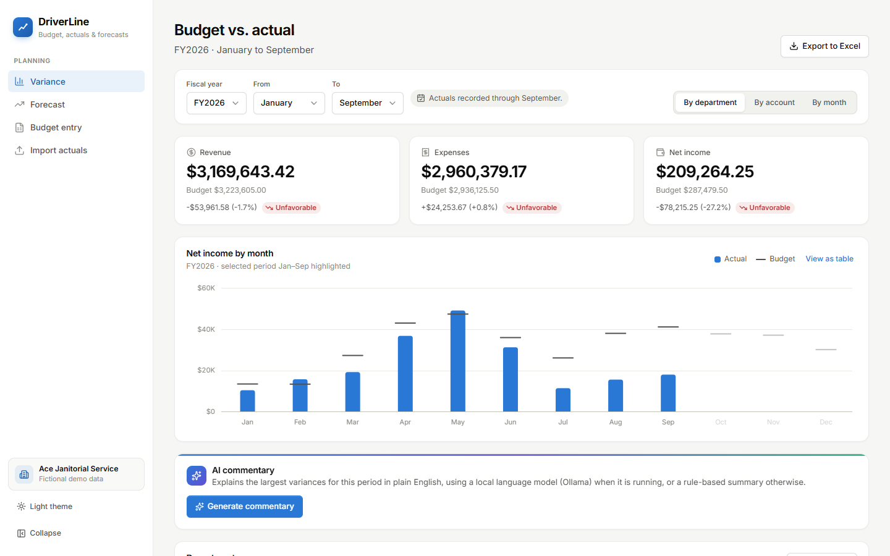

## Why this exists

Financial planning and analysis (FP&A) teams set a budget for the year, compare it every month against what the company actually earned and spent, and explain the differences (variances) to leadership. As the year goes on they re-forecast where it will end up. Much of this work lives in spreadsheets. DriverLine models that workflow in a web app, keeping Excel in the loop for import and export.

All data is for a fictional company, **Ace Janitorial Service** (about 50 employees, about $4M revenue), generated with realistic seasonality and a few business events that create meaningful variances: a lost contract, a fuel price spike, a supplier price increase.

## Features

- **Variance reports:** budget vs. actual by department, account and month, with dollar and percent variances and favorable/unfavorable flags that respect account type (revenue above budget is favorable; expenses above budget are unfavorable).
- **Drill-down** from department totals (net contribution) to individual accounts, and from any account to its monthly trend.
- **AI commentary:** a plain-English summary of the period's five largest variances, written by a local language model (`llama3.1:8b` via Ollama) in a separate commentary-service. Every figure of 1,000 or more in the model's answer is checked against the data; if the model is unavailable, slow, or its answer fails the check, a rule-based summary is shown instead, labelled with the reason.
- **Driver-based forecast:** the full-year outlook combines actuals for closed months with a forecast for the rest of the year, driven by business quantities: units × rate (active contracts × average contract value, cleaners × monthly cost), percent of revenue (supplies), or budget for fixed costs.
- **Base / Best / Worst scenarios:** separate driver values per scenario, edited side by side with a live preview and compared on one screen.
- **Excel export** of every report: live variance and `SUM` formulas, expandable department groups, accounting formats, colour-coded status, forecast months shaded, and a scenario comparison sheet.
- **Budget entry:** an editable monthly grid per department with live totals, inline validation and all-or-nothing saves.
- **Actuals import from CSV and Excel:** every row is validated first; a rejected file lists every problem by row, column and value, and nothing is saved. Re-importing a month replaces its amounts instead of duplicating them.
- **Charts and interface:** hand-built SVG charts (monthly actual vs. budget, cumulative net income with the Best–Worst range) with hover and keyboard tooltips, light and dark themes, a collapsible sidebar for wide tables, and status shown with an icon and a label as well as colour.

## Screenshots

| | |
| --- | --- |
| 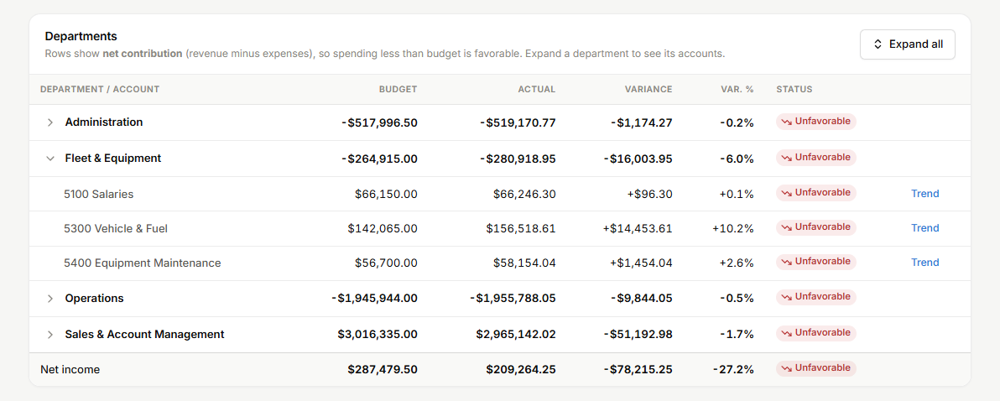 **Drill-down** from department net contribution to accounts | 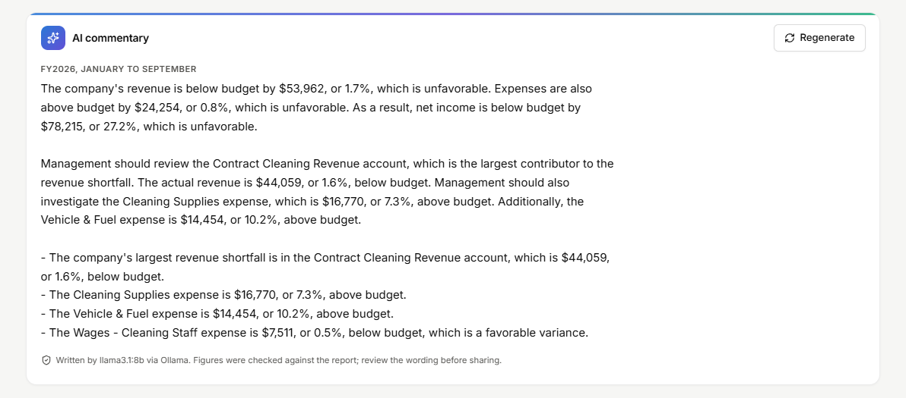 **AI commentary** written by `llama3.1:8b`, with its source shown |
| 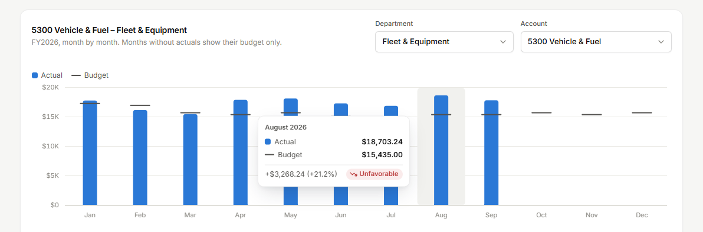 **Monthly trend** for one account, with a hover tooltip; months without actuals show budget only | 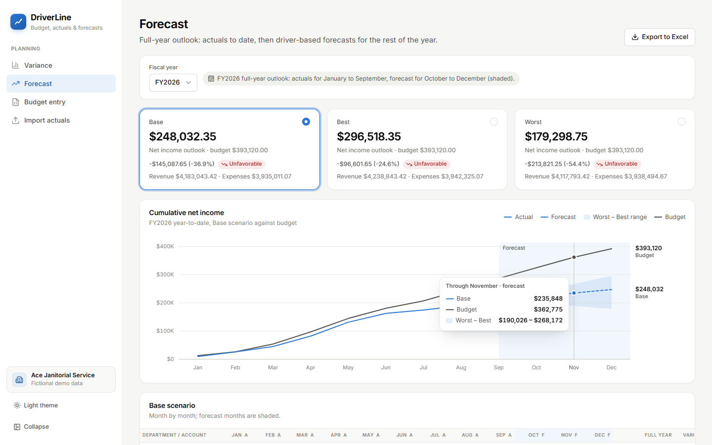 **Forecast:** Base/Best/Worst outlooks and cumulative net income against budget |
| 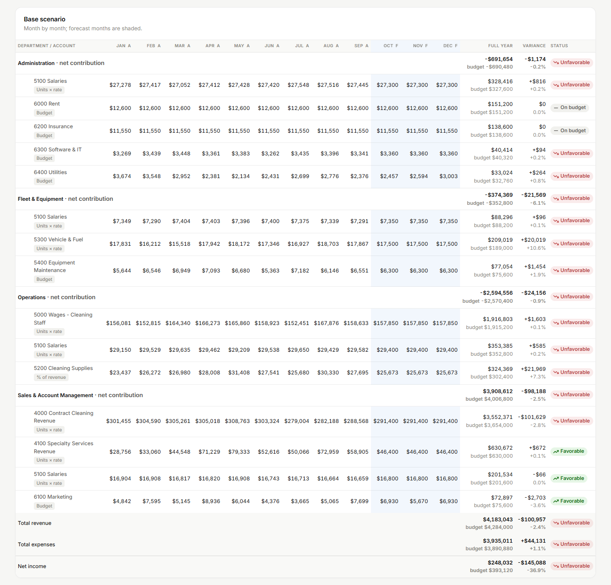 **12-month forecast** by line (forecast months shaded) | 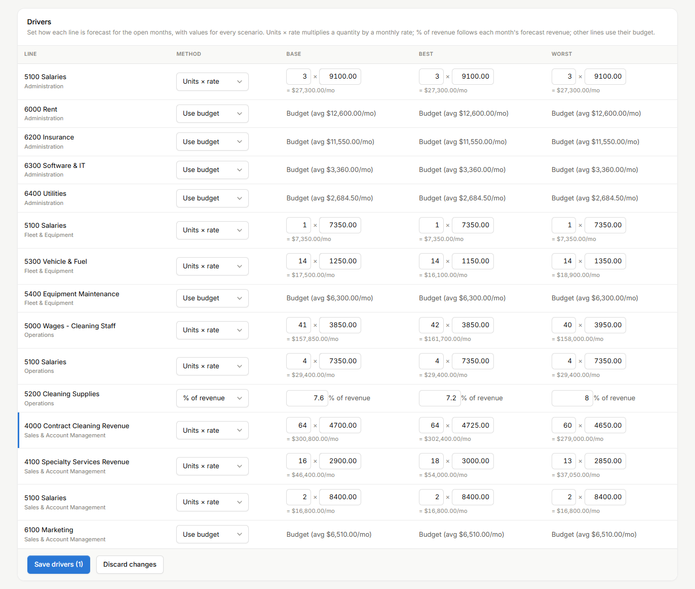 **Drivers** for every scenario, with a live monthly preview |
| 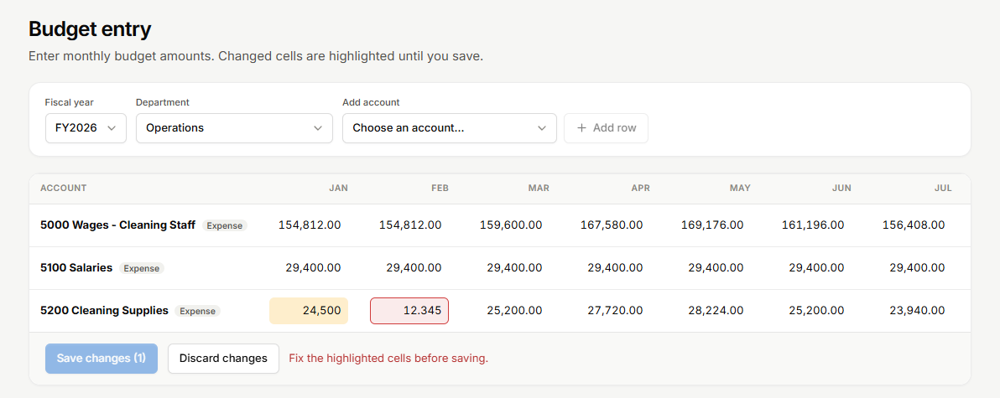 **Budget entry:** edited cells in yellow, invalid input in red | 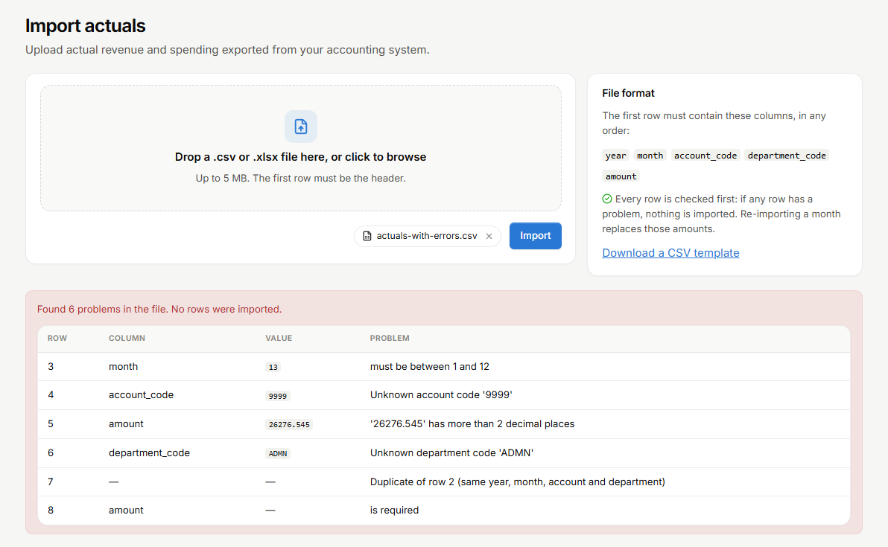 **Actuals import:** a file with mistakes is rejected with every row error listed |
| 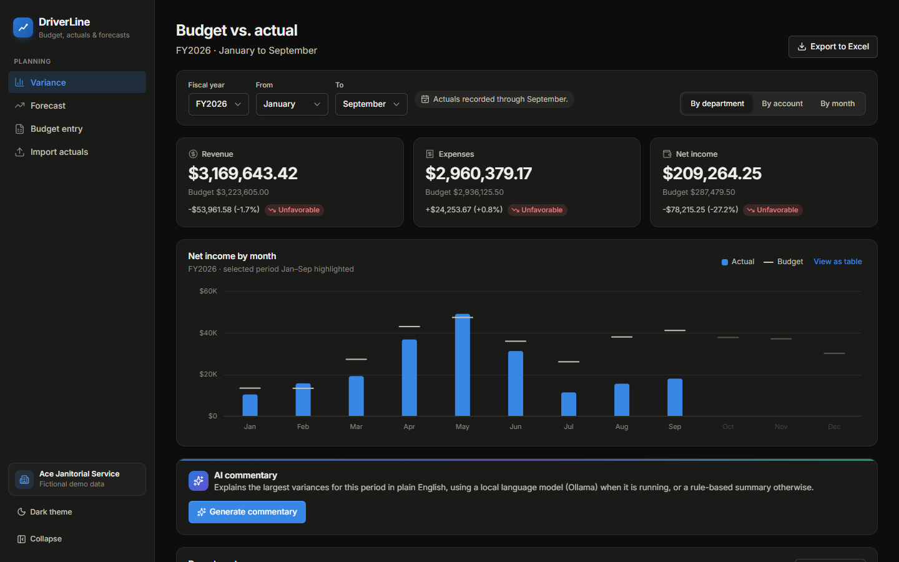 **Dark theme** (follows the system setting, or pick one) | |

## Run it with Docker (one command)

Requires [Docker Desktop](https://www.docker.com/products/docker-desktop/).

```powershell
docker compose up --build
```

Open **<http://localhost:8088>**. The first build takes a few minutes; the demo company is loaded automatically. API docs: <http://localhost:8088/swagger-ui.html>.

**AI commentary (optional):** install [Ollama](https://ollama.com) on the host and run `ollama pull llama3.1:8b` once. The commentary container reaches it at `host.docker.internal:11434`. Without Ollama, commentary is rule-based. `llama3.1:8b` needs about 5 GB of GPU memory to run quickly; on a CPU it works but is much slower.

Stop with `Ctrl+C` (or `docker compose down`). `docker compose down -v` also deletes the database, so the demo data is reloaded fresh next time.

## Architecture

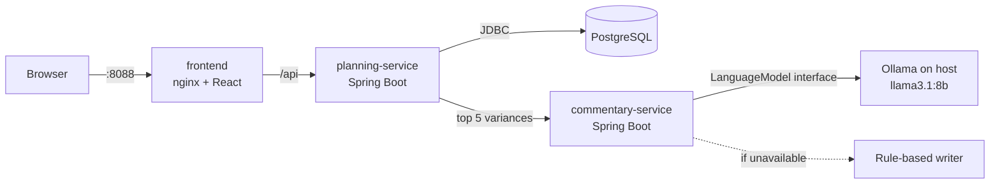

- **planning-service** owns all data and calculations: accounts, budgets, actuals import, variance reports, forecasts, scenarios, Excel export.
- **commentary-service** has no database. It turns the figures it is given into text and never recalculates them.
- **nginx** serves the React app and forwards `/api` to planning-service, so the browser talks to a single origin.

Details: [docs/architecture.md](docs/architecture.md) (data model, request flows), [docs/api.md](docs/api.md), and [docs/adr/](docs/adr/) (18 decision records).

## Tech stack

| Area | Technology | Why |
| --- | --- | --- |
| Frontend | React 19 + TypeScript (Vite), React Router | Component-based UI with static types; fast builds and dev server |
| UI | Plain CSS design tokens, Inter (self-hosted via Fontsource), Lucide icons, hand-built SVG charts | Light/dark theming from one set of variables; no chart library to fight for exact finance formatting |
| Frontend quality | Vitest + React Testing Library, ESLint + Prettier | Tests components the way a user uses them; consistent, linted code |
| Backend | Java 21 + Spring Boot 4, Maven | Mature, widely used stack for business services |
| Database | PostgreSQL 17 + Flyway | Reliable relational database; versioned, repeatable schema migrations |
| Money | `BigDecimal` / `NUMERIC(15,2)`, JSON strings, cents in the browser | Exact arithmetic end to end; no floating-point rounding errors |
| Excel | Apache POI, Apache Commons CSV | Reads and writes real .xlsx files with formulas and formatting; robust CSV parsing |
| AI | Ollama (`llama3.1:8b`) behind a `LanguageModel` interface | Free, private and runs on a laptop GPU; swappable, with a rule-based fallback |
| Backend tests | JUnit 5, Mockito, Testcontainers, MockMvc | Unit tests for every calculation; integration tests against a real PostgreSQL |
| API docs | springdoc-openapi | Swagger UI generated from the code, so it can't drift |
| Containers | Docker, Docker Compose, nginx | The whole stack runs the same way on every machine |
| CI | GitHub Actions | Builds, lints and tests everything, then starts the full stack and smoke-tests it, on every push |

## Run locally without Docker (for development)

Requires JDK 21+, Node.js 24 and Docker (for the database). Optional: Ollama.

```powershell
docker compose up -d postgres
```

Then, each in its own terminal:

```powershell
cd services\planning-service
.\mvnw.cmd spring-boot:run
```

```powershell
cd services\commentary-service
.\mvnw.cmd spring-boot:run
```

```powershell
cd frontend
npm install
npm run dev
```

Open <http://localhost:5173> (Vite forwards `/api` to planning-service on port 8080). Swagger UI: <http://localhost:8080/swagger-ui.html> and <http://localhost:8082/swagger-ui.html>. Configuration is through environment variables; see [`.env.example`](.env.example).

## Try it

1. **Variance:** the home page opens on FY2026, January–September. Expand **Fleet & Equipment** to find the fuel spike on Vehicle & Fuel, click **Trend**, export to Excel, and click **Generate commentary**.
2. **Forecast:** compare the Base, Best and Worst full-year net income, open a scenario's 12 months, then change a driver (for example active contracts) and save.
3. **Budget entry:** edit a few cells for Operations and save.
4. **Import actuals:** upload [`samples/actuals-with-errors.csv`](samples/) to see row-level validation, then `samples/actuals-2026-10.csv` (or the `.xlsx`) to add October. The variance report and forecast then treat October as actual.

## Tests

```powershell
cd services\planning-service
.\mvnw.cmd verify
cd ..\commentary-service
.\mvnw.cmd verify
cd ..\..\frontend
npm run lint
npm run typecheck
npm test
```

- **planning-service:** unit tests for every calculation (variance sign rules, percentages, zero budgets, forecasts, drivers, scenarios, parsers, Excel output), and Testcontainers integration tests that run the API against a real PostgreSQL (needs Docker running), including checks against independent SQL sums.
- **commentary-service:** never calls a real language model. It is mocked in unit tests, Ollama's HTTP API is mocked with `MockRestServiceServer`, and integration tests run with the model off or unreachable.
- **frontend:** Vitest + React Testing Library tests for the money utilities, chart scales, forecast series and every page.
- **Whole stack:** [`scripts/smoke-test.sh`](scripts/smoke-test.sh) checks a running `docker compose` stack through nginx; CI runs it on every push.

## Project structure

```
.
├── .github/workflows/       CI: backend (both services), frontend, full-stack Docker smoke test
├── docs/                    Architecture, API, decision records, screenshots
├── frontend/                React + TypeScript app (served by nginx in Docker)
├── samples/                 Example actuals files (valid CSV/XLSX and one with deliberate errors)
├── scripts/                 Smoke test and screenshot script
├── services/
│   ├── planning-service/    Spring Boot: planning data, reports, forecasts, Excel
│   └── commentary-service/  Spring Boot: AI variance commentary with rule-based fallback
├── docker-compose.yml       The whole stack (or just the database for local development)
└── .env.example             Environment variable template
```

## Known limitations

- Commentary checks figures of 1,000 or more against the data, but not the wording (for example whether it says "above" or "below"); the app labels AI text and asks users to review it before sharing.
- Forecast drivers are one value per month for the remaining months; there are no per-month driver curves yet.
- Single company and no user accounts or authentication: it is a portfolio project, not a multi-tenant product.
- The budget grid scrolls horizontally on narrower screens (12 editable months).
