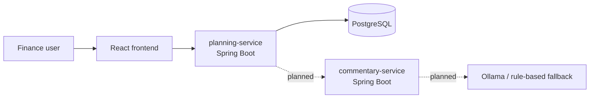

# DriverLine

[](https://github.com/YoussefElshafei/driverline/actions/workflows/ci.yml)

A budget vs. actual variance analysis and driver-based forecasting app for a small company's finance team.

> **Status:** early development (Phase 1 of 6). The database schema and a seeded demo company exist; there is no user-facing feature yet. The features below are planned, and this README is updated as each one ships.

## Why this exists

Financial planning and analysis (FP&A) teams set a budget for the year, compare it every month against what the company actually spent and earned, and explain the differences (variances) to leadership. They also re-forecast the rest of the year as conditions change. Much of this work is done in spreadsheets. DriverLine is a portfolio project that models that workflow in a web app built on a Java/Spring Boot and React/TypeScript stack.

All data in this project is for a fictional company.

## Demo company

On first start, the backend loads **Ace Janitorial Service**, a fictional commercial janitorial company with about 50 employees and about $4M in annual revenue:

- 4 departments (Sales & Account Management, Operations, Fleet & Equipment, Administration) and 12 accounts
- FY2025 budget and a full year of actuals; FY2026 budget and actuals for January–September
- Seasonal patterns (spring and back-to-school peaks for specialty cleaning, winter peaks for fuel and utilities) and a few business events that create visible variances

The data is generated in code from a fixed random seed, so every run produces the same numbers. Set `SEED_DEMO_DATA=false` to start empty. See [docs/architecture.md](docs/architecture.md#demo-data).

## Planned features

- Chart of accounts and departments
- Monthly budget entry per account and department
- Actuals import from CSV and Excel (.xlsx)
- Budget vs. actual variance reports with favorable/unfavorable flags and drill-down
- Excel export of reports
- Driver-based forecasting with Base / Best / Worst scenarios
- Plain-English variance commentary from a local LLM, with a rule-based fallback

## Architecture



See [docs/architecture.md](docs/architecture.md) for details and [docs/adr/](docs/adr/) for the decisions behind the design.

## Tech stack

| Area | Technology | Why |
| --- | --- | --- |
| Frontend | React + TypeScript (Vite) | Component-based UI with static types; Vite gives fast builds and dev server |
| Frontend tests | Vitest + React Testing Library | Vite-native test runner; tests components the way a user interacts with them |
| Frontend quality | ESLint + Prettier | Catch bugs and keep formatting consistent automatically |
| Backend | Java 21 + Spring Boot 4, Maven | Mature, widely used stack for business services |
| Database | PostgreSQL + Flyway | Reliable relational database; versioned, repeatable schema migrations |
| Backend tests | JUnit 5, Mockito, Testcontainers | Unit tests plus integration tests against a real PostgreSQL in Docker |
| Containers | Docker + Docker Compose | Same environment on every machine |
| CI | GitHub Actions | Builds, tests and lints on every push and pull request |

## Running the project

### Prerequisites

- Docker Desktop
- JDK 21 or newer
- Node.js 24

### Start the database

```powershell
Copy-Item .env.example .env
docker compose up -d
```

### Run the backend

```powershell
cd services\planning-service
.\mvnw.cmd spring-boot:run
```

Health check: <http://localhost:8080/actuator/health>

On startup, Flyway creates the schema and the demo company is loaded into the empty database. To reset the database, run `docker compose down -v` (this deletes the data volume), then `docker compose up -d`.

### Run the frontend

```powershell
cd frontend
npm install
npm run dev
```

Open <http://localhost:5173>.

## Running tests

Backend unit tests only (fast, no Docker needed):

```powershell
cd services\planning-service
.\mvnw.cmd test
```

Backend unit and integration tests (integration tests need Docker running):

```powershell
cd services\planning-service
.\mvnw.cmd verify
```

Frontend:

```powershell
cd frontend
npm run lint
npm run typecheck
npm test
```

## Project structure

```
.
├── .github/workflows/   CI pipeline
├── docs/                Architecture notes and decision records
├── frontend/            React + TypeScript app
├── services/
│   └── planning-service/  Spring Boot service
├── docker-compose.yml   Local PostgreSQL
└── .env.example         Environment variable template
```
