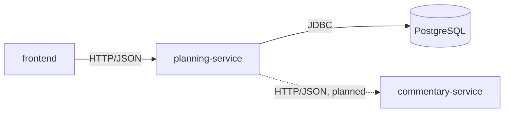

# Architecture

> Status: Phase 0. Only the skeleton exists. This document grows as each phase lands.

## Services

| Component | Status | Responsibility |
| --- | --- | --- |
| `frontend` | Skeleton | React + TypeScript UI, served by nginx in Docker |
| `planning-service` | Skeleton | Accounts, departments, budgets, actuals, variances, forecasts, scenarios, Excel import/export |
| `commentary-service` | Planned (Phase 5) | Generates plain-English variance commentary through a swappable LLM interface with a rule-based fallback |
| PostgreSQL | Running via Docker Compose | Stores all planning data; schema managed by Flyway |

## Data model

Defined in Phase 1.

## Request flow

Defined once the first endpoints exist (Phase 2).

## Health checks

`planning-service` exposes `GET /actuator/health`. It reports `UP` only when the service can reach the database.
