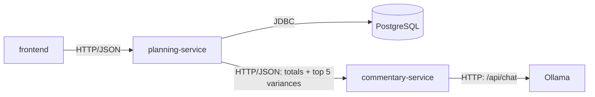
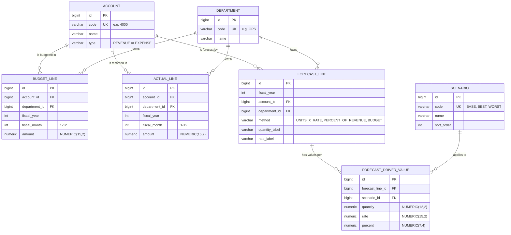
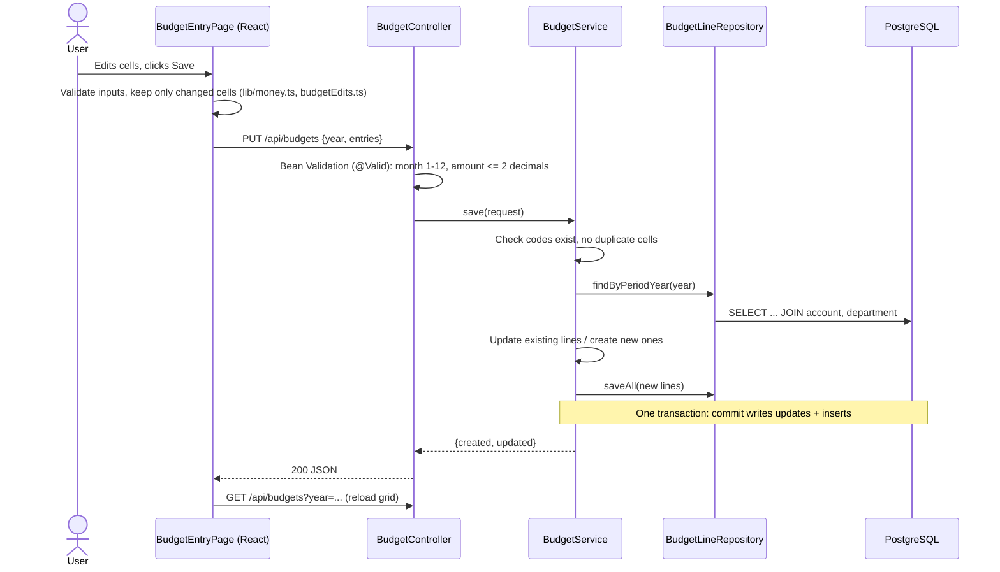
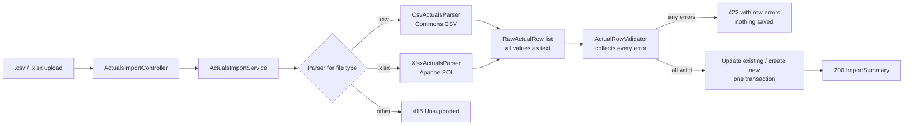
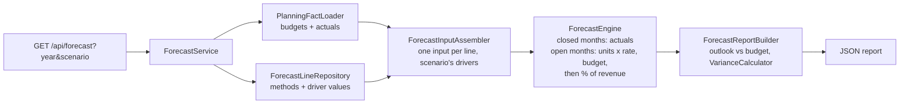
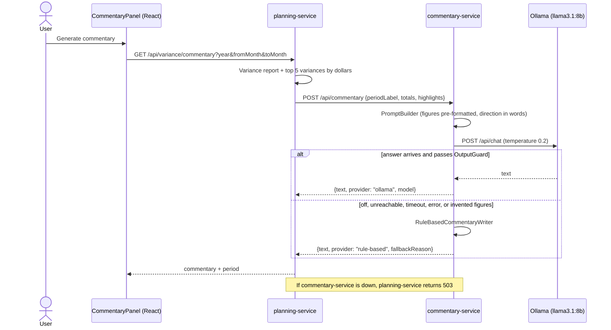
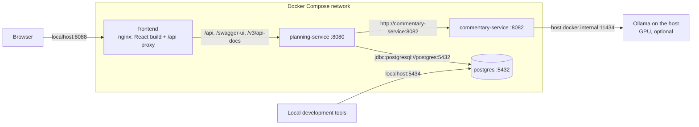

# Architecture

> Status: MVP complete (Phases 0–6). Everything described here is built, tested, and runs with `docker compose up --build`. The optional Azure deployment and Excel add-in phases are not built.

## Services

| Component | Status | Responsibility |
| --- | --- | --- |
| `frontend` | Variance, forecast, budget entry and actuals import pages | React + TypeScript UI, served by nginx in Docker |
| `planning-service` | Reference data, budgets, actuals import, variance reports, forecasting and Excel export built | Accounts, departments, budgets, actuals, variances, forecasts, scenarios, Excel import/export |
| `commentary-service` | Built (port 8082, no database) | Writes plain-English commentary on variances it is given, through a swappable `LanguageModel` (Ollama) with an output guard and a rule-based fallback |
| PostgreSQL | Running via Docker Compose | Stores all planning data; schema managed by Flyway |
| Ollama | Runs natively on the host (port 11434) | Local language model server; `llama3.1:8b` by default. Optional: without it, commentary is rule-based |



## Data model



Forecast tables (Phase 4, [ADR 0013](adr/0013-driver-based-forecast-model.md), [ADR 0014](adr/0014-scenarios-as-driver-value-sets.md)): one `forecast_line` per account × department × year holds the method; `forecast_driver_value` holds the values for each scenario. Lines without a `forecast_line` are forecast at their budget.

Key rules (see [ADR 0005](adr/0005-monthly-budget-and-actual-data-model.md)):

- One budget amount and one actual amount per **account × department × month**. A unique constraint on each table enforces this.
- The fiscal year matches the calendar year, so `fiscal_month = 1` is January.
- Amounts keep their natural sign (revenue and expenses are both positive). The account `type` decides whether a variance is favorable.
- Money is `NUMERIC(15,2)` in the database and `BigDecimal` in Java. It is never stored as floating point.
- The database enforces the same rules as the Java code (month 1–12, account type, uniqueness), so bad data can't get in through any path.

## Code layout

`planning-service` is organised by feature (see [ADR 0004](adr/0004-package-by-feature.md)):

```
com.driverline.planning
├── account      Account entity, AccountType, AccountRepository
├── department   Department entity, DepartmentRepository
├── reference    GET /api/accounts, /api/departments; ReferenceData lookup by code
├── budget       BudgetLine entity + repository, budget grid and save (controller, service, assembler, DTOs)
├── actual       ActualLine entity + repository
│   └── importing  CSV/XLSX parsers, row validator, import service and controller
├── variance     Variance rules (VarianceCalculator), reports and controller
│   ├── report     PlanningFact loading, ReportPeriod, VarianceReportBuilder (pure aggregation)
│   ├── dto        Report shapes returned by the API
│   └── export     ExcelReport layout, mapper and POI workbook writer
├── forecast     Scenario, ForecastLine, ForecastDriverValue entities; ForecastService, controller, validator
│   ├── engine     ForecastInputAssembler and ForecastEngine (pure: actuals + drivers -> 12 months per line)
│   ├── dto        Forecast report, scenario comparison and driver grid shapes
│   └── export     Forecast workbook writer (monthly columns + scenario sheet)
├── commentary   GET /api/variance/commentary: picks the top variances, calls commentary-service (client, selector, service)
├── period       FiscalPeriod value object (year + month)
├── common       LineKey, MoneyParser, money-as-string JSON config, global error handler, OpenAPI config, shared Excel helpers
└── seed         Demo company profile, data generator, loader
```

`commentary-service` is small and has no database:

```
com.driverline.commentary
├── api          POST /api/commentary controller and request/response records
├── generation   CommentaryService (LLM first, fallback on failure), PromptBuilder, OutputGuard, RuleBasedCommentaryWriter, Amounts
├── llm          LanguageModel interface, OllamaLanguageModel, configuration (provider, URL, model, timeouts)
└── common       Problem-details error handler, OpenAPI config
```

The frontend is organised the same way:

```
frontend/src
├── api           Typed fetch client and API types
├── lib           money.ts: parsing, cents arithmetic, formatting
└── features
    ├── variance  Variance page: department (drill-down), account and monthly views, summary cards, AI commentary panel
    ├── forecast  Forecast page: scenario cards, 12-month table, driver editor
    ├── budgets   Budget entry page, grid, edit-tracking logic
    └── actuals   Import page and error table
```

## Demo data

On startup, if the database is empty, `planning-service` loads **Ace Janitorial Service**, a fictional commercial janitorial company with about 50 employees (see [ADR 0006](adr/0006-deterministic-demo-data-generator.md)):

- 4 departments, 12 accounts, 15 budgeted account/department lines
- FY2025: full budget and 12 months of actuals
- FY2026: full budget and actuals for January–September

Budgets follow seasonal patterns (e.g. specialty cleaning peaks in spring and August). Actuals add small random noise from a fixed seed, plus a few business events that produce visible variances, such as a 2026 fuel price spike and a contract lost in July 2026. It also loads FY2026 forecast drivers (Base/Best/Worst) for nine lines if the year has none yet, so databases seeded before Phase 4 receive them too. Set `SEED_DEMO_DATA=false` to start with an empty database.

## Request flow

In development the browser only talks to the Vite dev server (port 5173), which forwards `/api/*` to planning-service (port 8080). Same origin for the browser means no CORS setup.

### Saving a budget



Any validation failure becomes an RFC 9457 problem-details response from `GlobalExceptionHandler` (400), and nothing is saved.

### Importing actuals



### Variance report

```mermaid
flowchart LR
    req[GET /api/variance/by-department] --> svc[VarianceService]
    svc --> load[PlanningFactLoader<br/>2 queries: budgets + actuals for the year]
    load --> facts[PlanningFact list<br/>one per account x department x month]
    facts --> period[ReportPeriod.resolve<br/>default Jan to latest closed month]
    period --> build[VarianceReportBuilder<br/>filter, group, net, sum]
    build --> calc[VarianceCalculator<br/>variance, %, favorability]
    calc --> json[JSON report]
    json -.export.-> excel[VarianceExcelMapper -> VarianceWorkbookWriter<br/>.xlsx with formulas + grouping]
```



Department totals are **net contribution** (revenue − expenses), so departments add up to company net income and each department's accounts add up to its total ([ADR 0011](adr/0011-net-contribution-and-closed-months.md)).

### Forecast



Forecasts are calculated on every request from the stored drivers, so a driver edit or a new month of actuals shows up immediately. `GET /api/forecast/compare` runs the engine once per scenario.

### AI commentary



See [ADR 0015](adr/0015-llm-behind-an-interface-with-fallback-and-guard.md) and [ADR 0016](adr/0016-planning-orchestrates-stateless-commentary-service.md).

## Deployment (Docker Compose)

`docker compose up --build` runs the whole stack ([ADR 0017](adr/0017-docker-compose-nginx-and-host-ollama.md)):



| Container | Image | Published port | Health check | Starts after |
| --- | --- | --- | --- | --- |
| postgres | `postgres:17-alpine` | 5434 (for local development) | `pg_isready` | — |
| planning-service | built from `services/planning-service` (JRE 21, non-root) | none | `GET /actuator/health` (includes the database) | postgres healthy |
| commentary-service | built from `services/commentary-service` (JRE 21, non-root) | none | `GET /actuator/health` | — |
| frontend | built from `frontend` (Node build, nginx runtime) | **8088** | `GET /` | both services healthy |

Inside the network, services address each other by name (`postgres`, `commentary-service`), so compose sets `DB_URL` and `COMMENTARY_SERVICE_URL` explicitly rather than using the local-development values in `.env`. The database volume (`postgres-data`) persists between runs; `docker compose down -v` deletes it and the demo company is reseeded on the next start.

CI starts this same stack on every push and runs [`scripts/smoke-test.sh`](../scripts/smoke-test.sh) through nginx.

## Health checks

- `planning-service`: `GET /actuator/health` reports `UP` only when the service can reach the database.
- `commentary-service`: `GET /actuator/health` reports `UP` when the service is running. It deliberately doesn't depend on Ollama, because the service still works (rule-based) without it.
- `frontend`: nginx answers `GET /`.
