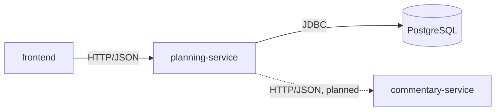
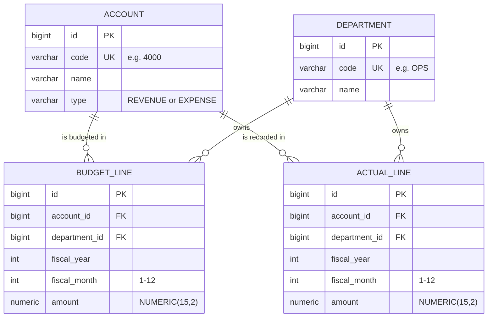

# Architecture

> Status: Phase 1. The data model, migrations, repositories and demo data exist. No REST endpoints yet beyond health checks.

## Services

| Component | Status | Responsibility |
| --- | --- | --- |
| `frontend` | Skeleton | React + TypeScript UI, served by nginx in Docker |
| `planning-service` | Data layer built | Accounts, departments, budgets, actuals, variances, forecasts, scenarios, Excel import/export |
| `commentary-service` | Planned (Phase 5) | Generates plain-English variance commentary through a swappable LLM interface with a rule-based fallback |
| PostgreSQL | Running via Docker Compose | Stores all planning data; schema managed by Flyway |



## Data model



Key rules (see [ADR 0005](adr/0005-monthly-budget-and-actual-data-model.md)):

- One budget amount and one actual amount per **account × department × month**. A unique constraint on each table enforces this.
- The fiscal year matches the calendar year, so `fiscal_month = 1` is January.
- Amounts keep their natural sign (revenue and expenses are both positive). The account `type` decides whether a variance is favorable.
- Money is `NUMERIC(15,2)` in the database and `BigDecimal` in Java. It is never stored as floating point.
- The database enforces the same rules as the Java code (month 1–12, account type, uniqueness), so bad data can't get in through any path.

## Code layout

`planning-service` is organised by feature (see [ADR 0004](adr/0004-package-by-feature.md)):

```
com.driverline.planning
├── account      Account entity, AccountType, AccountRepository
├── department   Department entity, DepartmentRepository
├── budget       BudgetLine entity, BudgetLineRepository
├── actual       ActualLine entity, ActualLineRepository
├── period       FiscalPeriod value object (year + month)
└── seed         Demo company profile, data generator, loader
```

## Demo data

On startup, if the database is empty, `planning-service` loads **Ace Janitorial Service**, a fictional commercial janitorial company with about 50 employees (see [ADR 0006](adr/0006-deterministic-demo-data-generator.md)):

- 4 departments, 12 accounts, 15 budgeted account/department lines
- FY2025: full budget and 12 months of actuals
- FY2026: full budget and actuals for January–September

Budgets follow seasonal patterns (e.g. specialty cleaning peaks in spring and August). Actuals add small random noise from a fixed seed, plus a few business events that produce visible variances, such as a 2026 fuel price spike and a contract lost in July 2026. Set `SEED_DEMO_DATA=false` to start with an empty database.

## Request flow

Defined once the first endpoints exist (Phase 2).

## Health checks

`planning-service` exposes `GET /actuator/health`. It reports `UP` only when the service can reach the database.
